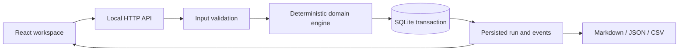

# WorkflowROI architecture

## Modules and flow

`web/Workspace.jsx` owns product-specific input flows. `web/App.jsx` manages loading, error, saved-state, history and exports. `src/domain.mjs` contains this product's rules and algorithms; the UI never reimplements those calculations. `src/validation.mjs` provides finite-number and text guards. `src/store.mjs` persists a workspace revision plus immutable run records and per-run events. `src/report.mjs` exports the selected result.

The API validates input before the domain operation. An atomic SQLite transaction writes the new workspace, run and events together. A caller must provide the current workspace revision; stale writes return 409. Runs have unique ids, observed creation timestamps and a separately measured local execution duration.

## Relational storage

| Table | Purpose |
|---|---|
| `workspace` | Current validated product state, revision and editable configuration |
| `run` | Immutable operation result, inputs/assumptions, findings, metrics and creation time |
| `run_event` | Ordered evidence records belonging to a run |

Product-specific entities are versioned JSON documents within the workspace and run snapshots, rather than pretending this MVP has a separate production warehouse. This preserves complete assumptions and simplifies reproducible local replay. Splitting high-volume entities into indexed relational tables is a future scaling task.

## Product decisions

- Set task volume, manual time, labor rates, implementation, maintenance and model/tool costs.
- Model residual manual work, human review and unresolved errors in three operating modes.
- Compute weekly risk-adjusted costs, positive-savings payback and first-year net value.
- Vary adoption and error loss independently to find where the decision changes.
- Recommend a measured pilot or do not automate when the economics fail the one-year horizon.

## Local boundary

No authentication, external execution, background telemetry or remote source fetching. Host and origin checks protect the local browser workflow from ordinary cross-origin writes; they are not a replacement for authenticated authorization. No arbitrary provider URLs are fetched. UI content uses React text rendering; exports retain provenance.
